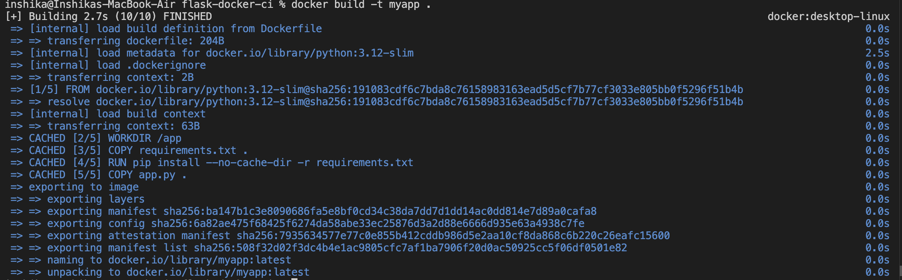
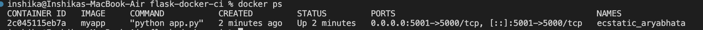
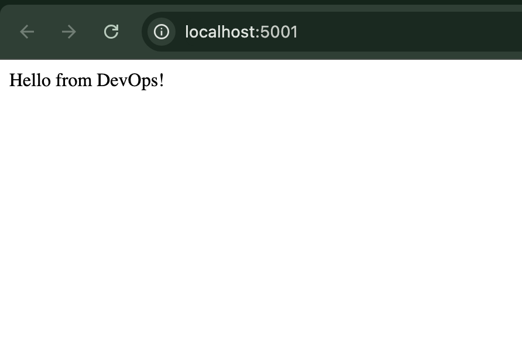

# Flask App with Docker and GitHub Actions

This is my submission for **Assignment 2: Dockerize a small app with a basic CI check**.

The app itself was given to us. It's a small Flask app with two routes. My job was to put it in a Docker container, get it running, and set up GitHub Actions so the image gets built automatically every time I push.


---

## What's in this repo

| File | What it does |
|---|---|
| `app.py` | The Flask app. `/` returns a hello message and `/health` returns `{"status": "ok"}` |
| `requirements.txt` | Python packages the app needs (just Flask) |
| `Dockerfile` | Instructions for building the Docker image |
| `.github/workflows/build.yml` | GitHub Actions workflow that builds the image on every push |
| `screenshots/` | Screenshots showing everything working |

---

## The Dockerfile

```dockerfile
FROM python:3.12-slim

WORKDIR /app

COPY requirements.txt .
RUN pip install --no-cache-dir -r requirements.txt

COPY app.py .

EXPOSE 5000

CMD ["python", "app.py"]
```

A quick explanation of what I did here:

- I started from `python:3.12-slim` because it already has Python and is much smaller than the full image.
- I copied `requirements.txt` and installed Flask **before** copying `app.py`. Docker caches each step, so if I only change the code later, it doesn't have to reinstall Flask every time.
- `EXPOSE 5000` documents the port the app listens on.
- `CMD` starts the app when the container runs.

---

## How to run it

You only need Docker installed.

**1. Clone the repo**
```bash
git clone https://github.com/YOUR-USERNAME/flask-docker-ci.git
cd flask-docker-ci
```

**2. Build the image**
```bash
docker build -t myapp .
```

**3. Run the container**
```bash
docker run -d -p 5001:5000 myapp
```
`-d` runs it in the background, and `-p 5001:5000` connects port 5001 on my Mac to port 5000 inside the container.

I first tried `-p 5000:5000`, but got `bind: address already in use`. On macOS, port 5000 is taken by AirPlay Receiver, so I mapped it to 5001 instead. The app inside the container still runs on 5000. On Linux or Windows, `-p 5000:5000` should work fine.

**4. Test it**
```bash
curl localhost:5001/health
```

Output:
```
{"status":"ok"}
```

You can also open http://localhost:5001 in the browser and it shows **Hello from DevOps!**

**5. Stop it when done**
```bash
docker ps                 # get the container ID
docker stop <container-id>
```

---

## Screenshots

**Building the image**



**Container running**



**Health check with curl**


**App in the browser**



---

## CI with GitHub Actions

The workflow is in `.github/workflows/build.yml`:

```yaml
name: Build Docker image

on:
  push:

jobs:
  build:
    runs-on: ubuntu-latest
    steps:
      - name: Check out code
        uses: actions/checkout@v4

      - name: Build Docker image
        run: docker build -t flask-devops-app .
```

Every time I push to GitHub, it:

1. Starts a fresh Ubuntu machine
2. Checks out my code
3. Runs `docker build`

If the build breaks (for example, a typo in the Dockerfile), the run fails and shows a red ❌ in the Actions tab. I didn't push the image to a registry because the assignment said it wasn't required.

**Successful workflow run**


---

## Bugs found and fixed

A teammate's version of this setup couldn't be reached. These are the problems I found and how I fixed them:

| # | Problem | Why it broke | Fix |
|---|---|---|---|
| 1 | Flask was running on `127.0.0.1` | Inside a container, `127.0.0.1` only accepts connections from inside the container itself, so nothing outside could reach it | Changed it to `app.run(host="0.0.0.0", port=5000)` |
| 2 | Container was started without `-p` | The port was never published to the host machine | Ran it with `docker run -p 5000:5000 myapp` |
| 3 | Port mismatch between `EXPOSE`/`-p` and the app | Traffic was being sent to a port the app wasn't listening on | Used port 5000 everywhere |
| 4 | `pip install` ran before `requirements.txt` was copied | The build failed because the file didn't exist yet | Moved `COPY requirements.txt .` above the `RUN pip install` line |

---

## What I learned

- A container is isolated, so the app has to listen on `0.0.0.0` **and** the port has to be published with `-p`. Missing either one means you can't reach it.
- The order of lines in a Dockerfile matters, both for whether it works and for build caching.
- GitHub Actions is an easy way to catch broken builds without having to check by hand.
