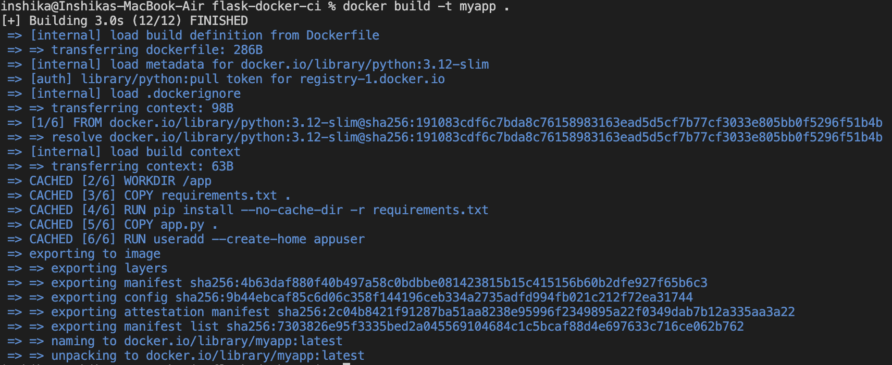
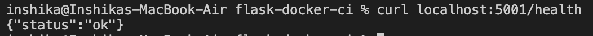
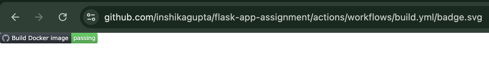

# Flask App with Docker and GitHub Actions

This is my submission for **Assignment 2: Dockerize a small app with a basic CI check**.

The app itself was given to us. It's a small Flask app with two routes. My job was to put it in a Docker container, get it running, set up GitHub Actions so the image gets built every time I push, and fix a teammate's Docker setup that wasn't working.


---

## What's in this repo

| File | What it does |
|---|---|
| `app.py` | The Flask app. `/` returns a hello message and `/health` returns `{"status": "ok"}` |
| `requirements.txt` | Python packages the app needs (just Flask) |
| `Dockerfile` | Instructions for building the Docker image |
| `.dockerignore` | Files I don't want copied into the image |
| `.github/workflows/build.yml` | GitHub Actions workflow that builds the image and checks `/health` on every push |
| `screenshots/` | Screenshots showing everything working |

---

## The Dockerfile

```dockerfile
FROM python:3.12-slim

WORKDIR /app

COPY requirements.txt .
RUN pip install --no-cache-dir -r requirements.txt

COPY app.py .

RUN useradd --create-home appuser
USER appuser

EXPOSE 5000

CMD ["python", "app.py"]
```

What each part does and why I wrote it this way:

- I started from `python:3.12-slim` because it already has Python and is much smaller than the full image.
- I copied `requirements.txt` and installed Flask **before** copying `app.py`. Docker caches each step, so when I only change the code, it doesn't reinstall Flask every time.
- `--no-cache-dir` stops pip from keeping its download cache, which makes the image a bit smaller.
- `useradd` creates a normal user called `appuser`, and `USER appuser` makes the app run as that user instead of root. If someone ever got into the app, they wouldn't have root inside the container. I checked it with `docker exec <container> whoami` and it printed `appuser`.
- `EXPOSE 5000` documents the port the app listens on.
- `CMD` starts the app when the container runs.

### .dockerignore

```
.git
screenshots/
README.md
__pycache__
.github/
.DS_Store
```

None of these are needed to run the app, so I keep them out of the image. It also makes the build a little faster because Docker has less to send.

---

## How to run it

You only need Docker installed.

**1. Clone the repo**
```bash
git clone https://github.com/inshikagupta/flask-app-assignment.git
cd flask-app-assignment
```

**2. Build the image**
```bash
docker build -t myapp .
```

**3. Run the container**
```bash
docker run -d -p 5001:5000 myapp
```
`-d` runs it in the background, and `-p 5001:5000` connects port 5001 on my Mac to port 5000 inside the container.

I first tried `-p 5000:5000`, but got `bind: address already in use`. I'm using a MacBook, and on macOS port 5000 is taken by **AirPlay Receiver**, so I mapped it to 5001 instead. The app inside the container still runs on 5000, so I didn't have to change the app or the Dockerfile. On Linux or Windows, `-p 5000:5000` works fine and you can test with `curl localhost:5000/health`.

**4. Test it**
```bash
curl localhost:5001/health
```

Output:
```
{"status":"ok"}
```

You can also open http://localhost:5001 in the browser and it shows **Hello from DevOps!**

**5. Stop it when done**
```bash
docker ps                 # get the container ID
docker stop <container-id>
```

---

## Screenshots

**Building the image**



**Container running**



**Health check with curl**


**App in the browser**


---

## CI with GitHub Actions

The workflow is in `.github/workflows/build.yml`:

```yaml
name: Build Docker image

on:
  push:

jobs:
  build:
    runs-on: ubuntu-latest
    steps:
      - name: Check out code
        uses: actions/checkout@v4

      - name: Build Docker image
        run: docker build -t myapp .

      - name: Run container
        run: docker run -d --name myapp -p 5000:5000 myapp

      - name: Check /health
        run: |
          for i in $(seq 1 10); do
            if curl -fs localhost:5000/health; then
              echo ""
              echo "Health check passed"
              exit 0
            fi
            echo "Waiting for the app to start..."
            sleep 2
          done
          echo "Health check failed"
          docker logs myapp
          exit 1
```

Every time I push to GitHub, it:

1. Starts a fresh Ubuntu machine
2. Checks out my code
3. Runs `docker build`
4. Starts the container on port 5000 (no AirPlay on GitHub's Linux machines, so 5000 is free there)
5. Calls `/health`. Flask needs a second or two to start, so instead of a fixed `sleep` it tries up to 10 times, 2 seconds apart. If the app never answers, it prints the container logs and fails the run.

If the build or the health check breaks, the run fails and shows a red ❌ in the Actions tab. I didn't push the image to a registry because the assignment said it wasn't required.

**Successful workflow run**



---

## Bugs found and fixed

A teammate wrote this setup, and the app couldn't be reached:

```dockerfile
FORM python:3.12-slim
WORKDIR /app
COPY . .
RUN pip install -r requirement.txt
CMD ["python", "app.py"]
```

Run with: `docker run -p 5000:8080 myapp`

These are the problems I found and how I fixed them:

| # | Problem | Why it broke | Fix |
|---|---|---|---|
| 1 | `FORM python:3.12-slim` | Typo. `FORM` isn't a Dockerfile instruction, so `docker build` fails on the very first line | Changed it to `FROM python:3.12-slim` |
| 2 | `RUN pip install -r requirement.txt` | The file is called `requirements.txt` (with an **s**), so pip can't find it and the build fails | Changed it to `RUN pip install -r requirements.txt` |
| 3 | `docker run -p 5000:8080 myapp` | `-p` is `host:container`, so this sends traffic to port **8080** inside the container. But Flask listens on port **5000**, so nothing answers. This is why the app "can't be reached" | Changed it to `docker run -p 5000:5000 myapp` (on my Mac I use `-p 5001:5000` because of AirPlay) |
| 4 | No `EXPOSE` line (small one) | Doesn't break anything by itself, but nothing in the Dockerfile says which port the app uses, which is how a mix-up like bug 3 happens | Added `EXPOSE 5000` |

On top of the fixes, I also changed `COPY . .` to copy `requirements.txt` first for better caching, added `--no-cache-dir`, and added the `.dockerignore` and the non-root user (these were the bonus points).

---

## What I learned

- A container is isolated, so the app has to listen on `0.0.0.0` **and** the port has to be published with `-p`. The right side of `-p` has to match the port the app really uses inside the container.
- The left side of `-p` is just any free port on my own machine. On my Mac, 5000 was taken by AirPlay, so I used 5001.
- The order of lines in a Dockerfile matters, both for whether it builds and for how fast it rebuilds.
- CI can do more than check that something builds. Starting the container and calling `/health` catches problems a build alone would miss.
